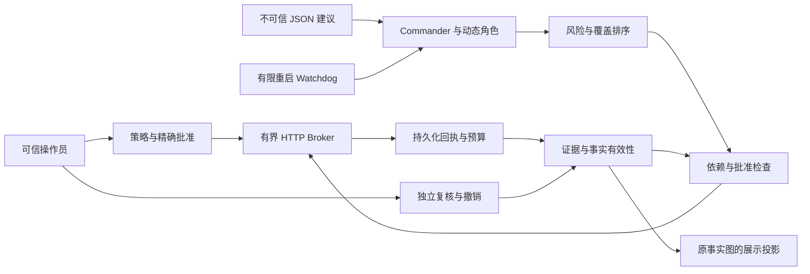

# 二次开发交接与持续迭代

本分支为 **受控 Mock 开发版**：实现授权执行、证据和调度基础设施，尚未接入自主运行的真实模型代理。使用入口见 [授权模式说明](AUTHORIZED-PENTEST.md)，交付验证见 [验收记录](ACCEPTANCE.md)，实施设计见 [开发计划](superpowers/plans/2026-10-31-authorized-pentest.md)。

## 项目与资源

- 仓库：`sweetyvicky/sapper-v2`；基线：`6098db01c44552c104a67e042827dbfac93ac140`。
- 开发分支：`feature/authorized-pentest`；交付 PR：[#1](https://github.com/sweetyvicky/sapper-v2/pull/1)。不合并或直接修改 `master`。
- 用户选择现有 Linux Docker。无需新增服务器、服务器密码、模型 API Key 或真实客户测试目标。
- Python 标准库实现；运行依赖 Linux `fcntl` 文件锁。Windows 主机通过 Linux Docker 运行，不支持原生 Windows 执行。
- 最初 GitHub 写入返回 403，经连接权限调整后，分支创建、源码提交及 PR 创建均已实际成功。云环境列表为空及原 SSH 认证失败不再阻碍此开发方案；不能把本机容器记录称为云端验证。

## 模块和责任边界

| 模块 | 负责什么 | 不能作为它的输入或权力来源 |
|---|---|---|
| `lib/pentest/policy.py` | 严格策略、目标规范化、工具和请求上限 | 任意命令字符串、未定义字段、隐式扩大的目标范围 |
| `lib/pentest/ledger.py` | 单次精确批准、持久化预算预留、执行回执 | 工作角色自报批准、重启后预算清零 |
| `lib/pentest/broker.py` | 固定目标 IP 的有界 HTTP GET/HEAD | 任意 Shell、代理环境变量、自动跳转或任意请求头/请求体 |
| `lib/pentest/evidence.py` | 回执验证、来源、依赖、撤销和独立复核 | 模型文字、导入 JSON 或图上标签直接升级为可信证据 |
| `lib/pentest/scheduler.py` | 风险、未覆盖工作、证据缺口与执行成本排序 | Flag 得分或模型自报成本扩大执行权限 |
| `lib/pentest/runtime.py` | Commander、动态角色、任务持久化、Watchdog 和图投影 | 可执行插件、模型进程或来自工作角色的批准/复核指令 |
| `lib/pentest/cli.py` | 可信操作员命令、JSON Mock 和临时回环演示 | 未认证的远程用户直接调用此操作员界面 |
| `lib/sapper.py`、`docker/` 启动脚本 | 保留旧图工具与明确选择的比赛模式 | 把旧任意工具模式等同于受控授权模式 |

## 必须持续保持的设计决定

1. **授权发生在执行时。** 排序只能决定先考虑哪项任务。Broker 在实际请求前重新核查策略、批准和预算；工作角色不能授予自己权限。
2. **只运行数据。** 当前适配器只处理 JSON，不能导入不可信 Python、启动真实模型 CLI 或执行任意命令。新工具必须逐个定义结构化参数、范围校验、资源计量和拒绝行为。
3. **事实来自回执。** 有效观察必须来自实际成功执行且校验一致的回执。运行层生成客观描述；工作角色的推测和原图文字不能被认证为观察事实。
4. **证据可失效。** 过期、撤销、依赖失效或数据损坏会阻断下游使用，并使相关复核状态失效；旧的正面复核不能在较新的证据失效后自动恢复。
5. **不重复不确定的请求。** 任务先持久化绑定的批准，再执行。恢复时查找该批准的既有回执，不重新挑一份批准重试。预算采用保守预留，失败或崩溃不退款。
6. **Watchdog 不作渗透决策。** 它只处理有限的工作角色恢复，不发批准、不扩范围、不补预算、不创造攻击工作。
7. **图是展示层。** 原图保留；同步以证据库重新生成可信字段。直接改图不会提高信任或使任务获得执行资格。
8. **旧模式需要明确选择。** `SAPPER_MODE=competition` 保留旧行为，是产品模式开关，不是对恶意进程的隔离措施。

## 状态、备份与故障处理

运行状态目录归可信控制器所有，包含策略/模式文件、`runtime.sqlite`、`ledger.sqlite`、`evidence.sqlite`、`claims/` 文件锁及 `.sapper/` 图。原始响应体可能存在账本和证据库中，不应提交到 Git 或公开发布。

- 备份前先停止所有使用该状态目录的控制器，确认没有执行中的请求，然后整体复制目录。不要在运行期间只复制单个 SQLite 文件，也不要单独回滚账本或证据库。
- 状态绑定策略指纹和绝对路径。不能通过编辑策略、复制到新路径、删除账本或修改数据库获得新的预算。当前没有状态迁移/改路径工具。
- 如发现损坏或指纹不一致，保留原始目录和错误记录，停止执行，先定位原因；不要以清库、重建或无限重试掩盖错误。
- 锁与数据库超时按保守失败处理。证据检查在有界请求期间保留写锁，可能串行化多个工作角色的执行；首版不承诺高吞吐并行。
- 审计身份是操作员填写的归属信息，不是身份认证。若以后开放远程 UI/API，必须新增真实身份验证、操作授权和批准展示。

## 验证与评审纪律

在 Linux Docker 的 `--network none` 容器中运行单元/集成测试、演示与 Shell 语法检查；源码只读，不挂载密钥，不发布端口，不调用真实模型。具体可复制命令见授权模式说明。当前开发流程采用 writing-plans、test-driven-development、subagent-driven-development、requesting-code-review、systematic-debugging 和 verification-before-completion。

修复需先形成能复现问题的行为测试，再验证修复后的结果。安全边界或共享状态变化必须做独立评审。只有源码树与实际测试对象一致时才能写入验收结论。

已发现并修复的关键问题，后续不可退化：

| 问题 | 修复与回归覆盖 |
|---|---|
| Linux 未指定地址 `0.0.0.0` / `::` 可能在连接后校验前接触回环 | 在连接前拒绝；真实 TCP 监听器断言未收到连接 |
| 深层损坏 JSON 产生递归异常，越过证据错误边界 | 有界错误处理；损坏证据、事实、复核和回执路径回归 |
| 回执验证耗时期间依赖过期，但旧检查仍允许进入执行区 | 验证后重新取时间并检查直接与传递依赖期限 |
| 工作角色夸大的文字或直接编辑图字段冒充观察结论 | 控制器生成中性观察描述，图投影覆盖可信字段，编辑保留为不可信注释 |
| 超长数字或证据领域错误使 CLI 输出异常堆栈 | 在 JSON 解析处翻译预期错误、显式处理 EvidenceError；脚本与模块两个真实入口验证拒绝 |
| 重启或并发控制器造成重复请求 | 持久化批准绑定、按任务文件锁和回执恢复；两个真实进程验证一次执行 |

上述测试验证特定故障场景，不代表已经穷举断电、操作系统故障或所有并发交错。

## 后续迭代清单

| 顺序 | 工作 | 开始前需要什么 | 验收重点 |
|---|---|---|---|
| 1 | 独立隔离的真实模型适配器 | 另行选择模型入口及预算；在连接设置中配置，不能把密钥放进提案 | 模型进程拿不到控制器账本/批准凭据；只能发结构化建议；禁止绕过出口 |
| 2 | 域名目标支持 | 明确授权域名与网络范围，定义解析/重绑定策略 | 所有解析结果校验、地址固定、TLS 验证、跳转与重新解析测试 |
| 3 | 更多结构化工具 | 每种工具的参数、目标语义和资源预算 | 未定义参数拒绝、命令注入/子进程/辅助网络出口不能绕过边界 |
| 4 | 操作员界面与身份体系 | 真实的多人审批要求 | 身份认证、最小权限、准确展示精确动作和剩余预算 |
| 5 | 性能和状态迁移 | 可量化并发需求与版本升级场景 | 锁顺序、预算竞争、备份恢复、无重复执行与兼容迁移 |
| 6 | 更丰富的授权靶场 | 用户明确给出的隔离靶场范围 | 先用可复现实验验证，再讨论真实环境接入 |

不得因后续加入模型或新工具而移除现有默认拒绝、回执来源检查和离线回归。获得一个 HTTP 响应也不等于发现或确认漏洞。
